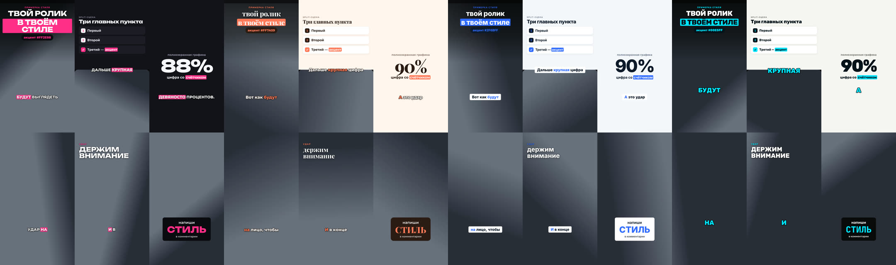

# AI Montage Kit — ИИ-монтажёр вертикальных роликов под твой стиль

Скачиваешь проект, открываешь в **Claude Code** или **Codex** и отвечаешь на 8 коротких вопросов агента про стиль монтажа:
как снимаешь, какие ролики нравятся, цвета, субтитры, темп. Дальше кидаешь видео в `inbox/` и пишешь «смонтируй ролик». Агент:

- **чистит живую запись**: паузы, «э-э», неудачные дубли, повторы;
- **ставит субтитры** в твоём стиле: плашка, подсветка слова, обводка или по одному слову;
- **делает хук** с первого кадра — заголовок от боли зрителя;
- **подбирает графику** под фразы: списки, цифры, сравнения, титулы, скрины сайтов, логотипы, b-roll, чат с ИИ;
- **держит ритм**: наезды на лицо, смена раскладок, jump-cut на склейках;
- **сводит звук**: эффекты, фоновую музыку под темп, громкость под соцсети;
- **смотрит видео** — референсы по ссылке (YouTube, Reels, TikTok) или файлом, и свой готовый ролик перед сдачей;
- **заканчивает** CTA с кодовым словом и рендерит MP4 1080×1920.

Подходит и для **ИИ-аватара** (HeyGen и др.), и для **обычной говорящей головы** с телефона или камеры.
Движок — [HyperFrames](https://hyperframes.dev): ролик собирается как HTML-страница с анимацией, а потом рендерится в видео.



## Быстрый старт

```bash
git clone <ссылка на репозиторий> ai-montage-kit
cd ai-montage-kit
./setup.sh
```

Заранее нужны только **Node.js** (LTS с [nodejs.org](https://nodejs.org)) и **Python 3** (на Mac при первом запуске
предложит установиться сам). Всё остальное `setup.sh` кладёт прямо в папку проекта — без Homebrew и прав администратора:
ffmpeg, yt-dlp (видео по ссылкам), модель распознавания речи (~470 МБ, один раз), браузер для рендера,
официальные скиллы HyperFrames.

Открой папку в агенте — **Claude Code** (терминал `claude`, приложение Claude, расширение VS Code / Cursor) или
**Codex** (терминал `codex`, приложение, расширение) — и напиши что угодно, например «привет».

Агент увидит, что монтаж ещё не настроен, покажет **8 коротких вопросов** — только про стиль монтажа — и задаст их
по одному. Можно отвечать коротко, «не знаю» или «пропусти» — агент предложит вариант сам. Прервался — в следующий
раз продолжит с того же места (`studio/onboarding.md`). В конце покажет превью твоего стиля.

**Что подготовить** (вопросы — [docs/QUESTIONS.md](docs/QUESTIONS.md)):
- ⭐ 3–5 роликов, монтаж которых тебе нравится — ссылки (YouTube, Reels, TikTok) или файлы, агент сам их посмотрит;
- по желанию — своё видео, как обычно снимаешь (покажет превью стиля на твоём кадре);
- если есть: логотип (PNG), фирменные цвета и шрифт, свои треки с лицензией.

Кидай всё в папку `inbox/`. Дальше на каждый ролик — видео в `inbox/` и «смонтируй ролик» (в Claude Code — `/make-reel`).
Поменять стиль — «поменяй субтитры / цвет / шрифт» (`/style-lab`).

Главный файл с инструкциями для агента — `AGENTS.md`, его читают и Claude Code (v2.1.277+), и Codex.
Сценарии работы — `.agents/skills/`.

## Что нужно
- macOS (Apple Silicon или Intel), Linux или Windows через WSL;
- Node.js 18+ и Python 3.9+ — поставить самому; остальное ставит `setup.sh`;
- ~1.5 ГБ на диске и интернет при первом запуске;
- подписка Claude (Pro/Max) для Claude Code или ChatGPT (Plus/Pro) для Codex.

## Как устроено

```
studio/     твой профиль: стиль, референсы, логотипы, шрифты, музыка, финал роликов   ← настраивает агент
inbox/      сюда кидаешь видео и материалы
videos/     проекты роликов и готовые MP4
engine/     движок: сборщик и библиотека сцен
tools/      инструменты: распознавание, чистка, захват сайтов, музыка, стиль…
presets/    готовые стили: Чистый, Лайм-тех, Неон, Деловой, Тёплый лайфстайл, Слово за словом
docs/       анкета, правила режиссёра, монтаж по референсу, справочник стиля
```

Стиль живёт в `studio/studio.json`: цвета, шрифты, субтитры, плашки, CTA, положение спикера, темп, звук.
Справочник — [docs/STYLE.md](docs/STYLE.md). Править можно словами («сделай субтитры капсом и розовыми»),
агент сам поменяет настройки и покажет превью.

## Ручной режим (без агента)

```bash
python3 tools/studio.py presets                       # готовые стили
python3 tools/studio.py init neon                     # выбрать стиль
python3 tools/style_preview.py                        # превью → studio/preview.jpg
python3 tools/cleanup.py raw.mp4 videos/my-reel       # план чистки живой записи → videos/my-reel/source/plan.md
python3 tools/cleanup.py raw.mp4 videos/my-reel --apply
python3 tools/transcribe.py videos/my-reel/source/clean.mp4 videos/my-reel
# написать videos/my-reel/shotlist.json по docs/DIRECTOR.md (каталог сцен: python3 engine/catalog.py)
python3 engine/build.py videos/my-reel
./hf render videos/my-reel/public -o videos/my-reel/output.mp4 --fps 25
python3 tools/finalize.py videos/my-reel
```

## Права
- Звуковые эффекты — Pixabay (коммерческое использование разрешено, см. `assets/sfx/CREDITS.md`).
- Логотипы сервисов — товарные знаки их владельцев; используются для упоминания сервиса в ролике.
- Шрифты — Google Fonts / Fontsource (OFL).
- Музыка: свои треки клиента (`studio/music/`, с лицензией) или каталог HeyGen через скиллы HyperFrames.
- Ролики-референсы — только как ориентир по стилю и короткие демо продукта. Чужое лицо, голос и субтитры не переносим.

## Если агент не начинает анкету
- Claude Code: обнови до последней версии (`claude update`) — чтение `AGENTS.md` появилось в v2.1.277. Запускай агента
  **в папке проекта**. Если выше по папкам лежит чей-то `CLAUDE.md`, Claude читает его вместо `AGENTS.md` —
  тогда просто напиши: «прочитай AGENTS.md и начни настройку».
- Codex: запускай в папке проекта; `AGENTS.md` читается автоматически.
